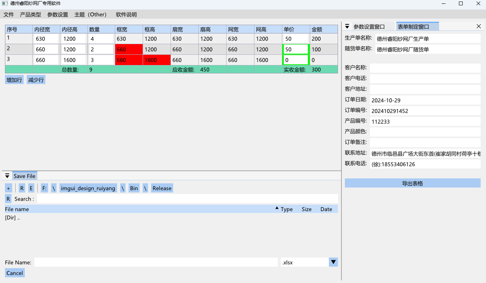

# imgui_design_ruiyang

# 主要内容

通过imgui为德州睿阳纱网厂制作的一款软件。主要是可以制作表格，输出表格，指定产品类型，自动计算等功能。

# 版本运行环境

Visual Studio2022  x86-Release

# 主要包含库

**gl3w**      
**glfw**
**imgui**
**imguiFileDialog**
**libxlsxwrite**            ：：处理xlsx文件，可使用vcpkg安装
**mini**                    ：：处理ini文件
**pugixml**                 ：：处理xml文件

